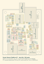

# Forest Sensor Platform V1 - assembly list

One row per part, grouped by type and sorted by value. Every part goes on the top side;
J4, J6, J7 and J14 are through-hole, the rest SMD. Test pads (TP1-TP9) and mounting
holes (H1-H4) have nothing to fit and are left out. "Review" notes refer to
[BOARD-REVIEW.md](BOARD-REVIEW.md).

Before you start:

- Leave off R33, C26 and C27.
- Y2's footprint is mirrored: fit the crystal turned 90 degrees.
- D7 must be the unmarked (bidirectional) SMAJ5.0CA.
- R35 is unresolved: 100 ohm or a 0 ohm jumper.

Placement map ([assembly-map.svg](assembly-map.svg)): each square is a part's courtyard,
labeled with its reference and value.

## Capacitors

| Ref | Value | Package | Part number | Note |
| --- | --- | --- | --- | --- |
| C26 | 18pF | 0603 | - | **DO NOT FIT** (review H2) |
| C27 | 18pF | 0603 | - | **DO NOT FIT** (review H2) |
| C29 | 100nF | 0603 | - |  |
| C10 | 100nF 50V | 0603 | CC0603KRX7R9BB104 |  |
| C15 | 100nF 50V | 0603 | CC0603KRX7R9BB104 |  |
| C16 | 100nF 50V | 0603 | CC0603KRX7R9BB104 |  |
| C19 | 100nF 50V | 0603 | CC0603KRX7R9BB104 |  |
| C21 | 100nF 50V | 0603 | CC0603KRX7R9BB104 |  |
| C32 | 100nF 50V | 0603 | CC0603KRX7R9BB104 |  |
| C44 | 100nF 50V | 0603 | CC0603KRX7R9BB104 |  |
| C34 | 1uF | 0603 | CGA3E1X7R1E105K080AC |  |
| C30 | 1uF 25V | 0603 | CGA3E1X7R1E105K080AC |  |
| C12 | 1uF 25V | 0805 | C0805C105K3RACTU |  |
| C14 | 1uF 25V | 0805 | C0805C105K3RACTU |  |
| C24 | 1uF 50V | 0603 | CL10A105KB8NNNC |  |
| C28 | 2.2uF | 0603 | - |  |
| C9 | 10uF 25V | 0603 | GRT188R61E106ME13D |  |
| C13 | 10uF 25V | 0603 | GRT188R61E106ME13D |  |
| C31 | 10uF 25V | 0603 | GRT188R61E106ME13D |  |
| C35 | 10uF 25V | 0603 | GRT188R61E106ME13D |  |
| C11 | 10uF 50V | 1206 | GMT31X7R106K50NT2 |  |
| C20 | 10uF 50V | 1206 | GMT31X7R106K50NT2 |  |
| C46 | 22uF 16V | 0603 | CL10A226MO7JZNC |  |
| C22 | 47uF 10V | 1206 | GRM31CR61A476ME15L |  |
| C23 | 47uF 10V | 1206 | GRM31CR61A476ME15L |  |

## Resistors

| Ref | Value | Package | Part number | Note |
| --- | --- | --- | --- | --- |
| R42 | 0 ohm | 0603 | RMCF0603ZT0R00 |  |
| R43 | 0 ohm | 0603 | RMCF0603ZT0R00 |  |
| R33 | 0 ohm | 0805 | RMCF0805ZT0R00 | **DO NOT FIT** (review P2) |
| R34 | 0 ohm | 0805 | RMCF0805ZT0R00 |  |
| R1 | 50 milliohm shunt | 2512 | MCSF2512FR050Q9 |  |
| R56 | 22 ohm | 0603 | RMCF0603FT22R0 |  |
| R35 | 100 ohm | 0805 | RMCF0805ZT0R00 | Value and part number disagree; confirm before fitting (review M6) |
| R19 | 1K | 0603 | RMCF0603FT1K00 |  |
| R38 | 1K | 0603 | RMCF0603FT1K00 |  |
| R39 | 1K | 0603 | RMCF0603FT1K00 |  |
| R40 | 1K | 0603 | RMCF0603FT1K00 |  |
| R41 | 1.5K | 0603 | - |  |
| R58 | 2.2K | 0603 | RMCF0603FT2K20 |  |
| R27 | 4.7K | 0603 | RMCF0603FT4K70 |  |
| R28 | 4.7K | 0603 | RMCF0603FT4K70 |  |
| R54 | 4.7K | 1206 | RMCF1206FT4K70 |  |
| R25 | 5.1K | 0603 | RMCF0603FT5K10 |  |
| R26 | 5.1K | 0603 | RMCF0603FT5K10 |  |
| R12 | 10K | 0603 | RMCF0603FT10K0 |  |
| R13 | 10K | 0603 | RMCF0603FT10K0 |  |
| R14 | 10K | 0603 | RMCF0603FT10K0 |  |
| R15 | 10K | 0603 | RMCF0603FT10K0 |  |
| R16 | 10K | 0603 | RMCF0603FT10K0 |  |
| R17 | 10K | 0603 | RMCF0603FT10K0 |  |
| R18 | 10K | 0603 | RMCF0603FT10K0 |  |
| R23 | 10K | 0603 | - |  |
| R24 | 10K | 0603 | - |  |
| R29 | 10K | 0603 | RMCF0603FT10K0 |  |
| R30 | 10K | 0603 | RMCF0603FT10K0 |  |
| R57 | 10K | 0603 | RMCF0603FT10K0 |  |
| R11 | 100K | 0603 | RMCF0603FT100K |  |
| R55 | 100K | 0603 | RMCF0603FT100K |  |
| R21 | 1M | 0603 | RMCF0603FT1M00 |  |
| R22 | 1M | 0603 | RMCF0603FT1M00 |  |
| R31 | 1M | 0603 | RMCF0603FT1M00 |  |
| R36 | 1M | 0603 | RMCF0603FT1M00 |  |
| R37 | 1M | 0603 | RMCF0603FT1M00 |  |
| R44 | 1M | 0603 | RMCF0603FT1M00 |  |

## Inductors

| Ref | Value | Package | Part number | Note |
| --- | --- | --- | --- | --- |
| L5 | 2.2uH | 1008 | AOTA-N252010S-2R2MT |  |
| L6 | 33uH | 6 x 6 mm | SRN6045TA-330M |  |

## Diodes and LEDs

| Ref | Value | Package | Part number | Note |
| --- | --- | --- | --- | --- |
| D1 | 12V zener | SOD-123 | BZT52B12 |  |
| D4 | 43V TVS | SMB | P6SMBJ43A |  |
| D7 | 5V TVS, bidirectional | SMA | SMAJ5.0CA | Unmarked bidirectional part only; the silkscreen bar is the GND end (review P1) |
| D10 | LED | 0603 | - |  |
| D11 | LED | 0603 | - |  |
| D2 | LED, green | 0603 | LTST-C190KGKT |  |
| D3 | LED, green | 0603 | LTST-C190KGKT |  |
| D6 | LED, green | 0603 | LTST-C190KGKT |  |
| D12 | LED, green | 0603 | LTST-C190KGKT |  |
| D5 | Schottky 60V 5A | SMA | SK56A-LTP |  |
| D8 | Schottky 60V 5A | SMA | SK56A-LTP |  |

## Transistors

| Ref | Value | Package | Part number | Note |
| --- | --- | --- | --- | --- |
| Q1 | Dual NPN/PNP | SOT-363 | MBT3946DW1T2G |  |
| Q3 | N-MOSFET 100V | SOT-23 | BSS123NH6433XTMA1 |  |
| Q2 | P-MOSFET 60V | TO-252 (DPAK) | MCAC054P10Y-TP |  |

## ICs and modules

| Ref | Value | Package | Part number | Note |
| --- | --- | --- | --- | --- |
| U10 | 3.3V LDO | WSON-6 2x2 | TLV75733PDRVR |  |
| U11 | 5V boost | SOT-23-5 | TPS613222ADBVR |  |
| U9 | CH572D MCU | QFN-20 3x3 | CH572D |  |
| U1 | Current-sense amp | SOT-23-6 | INA181A1IDBVR |  |
| U2 | Ideal-diode OR | SOT-583-8 | LM66200DRLR |  |
| U8 | Ideal-diode OR | SOT-583-8 | LM66200DRLR |  |
| U7 | Load switch | 4-pad, 0.4 mm pitch | TPS22991CRAAR |  |
| U13 | Load switch | 4-pad, 0.4 mm pitch | TPS22991CRAAR |  |
| U6 | RS-485 transceiver | MSOP-10 | TPT482-VS2R |  |
| U3 | Wio-E5 LoRa module | module | LoRa-E5-HF |  |

## Crystal

| Ref | Value | Package | Part number | Note |
| --- | --- | --- | --- | --- |
| Y2 | 32 MHz crystal | 2.0 x 1.6 mm | XRCGB32M000F1S1DR0 | **Turn 90 degrees** from the footprint, either way (review P3) |

## Fuse

| Ref | Value | Package | Part number | Note |
| --- | --- | --- | --- | --- |
| F1 | PTC fuse | 1206 | KLM3S500RY |  |

## Switch

| Ref | Value | Package | Part number | Note |
| --- | --- | --- | --- | --- |
| SW1 | Tact switch (Wio reset) | SMD 4.5 mm | PTS647SK38SMTR2 LFS |  |

## Connectors

| Ref | Value | Package | Part number | Note |
| --- | --- | --- | --- | --- |
| J1 | USB-C receptacle | SMD | UJ20-C-H-G-SMT-2A-P16-TR |  |
| J2 | 5-pin JST SH | SMD | BM05B-SRSS-TB |  |
| J3 | microSD socket | SMD | MSD-1-A |  |
| J4 | 2-pin header (power) | through-hole | M20-9990246 |  |
| J6 | XT30 (battery) | through-hole | XT30PW-M |  |
| J7 | 6-way screw terminal | through-hole | OSTVN06A150 |  |
| J8 | 4-pin JST SH (I2C1) | SMD | BM04B-SRSS-TB |  |
| J9 | U.FL | SMD | Molex 73412-0110 |  |
| J10 | 4-pin JST SH (I2C2) | SMD | BM04B-SRSS-TB |  |
| J14 | 4-pin JST XH (solar in) | through-hole | S4B-XH-A-1 |  |
| SMA1 | SMA edge connector | edge mount | SMA-J-P-H-ST-EM1 |  |

